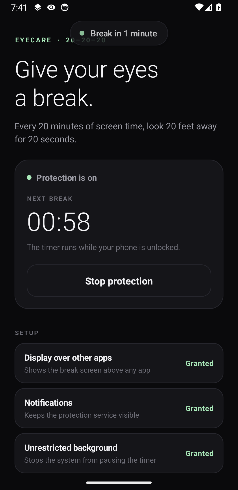
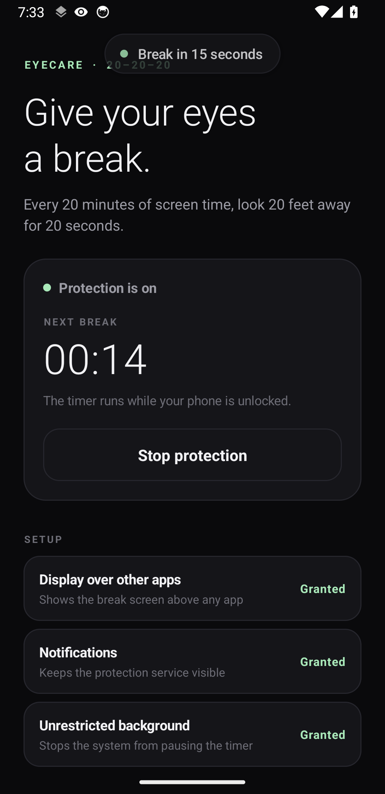
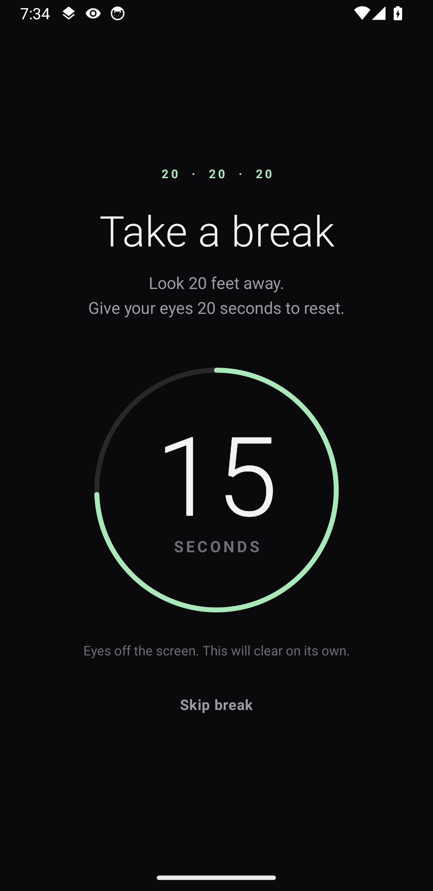
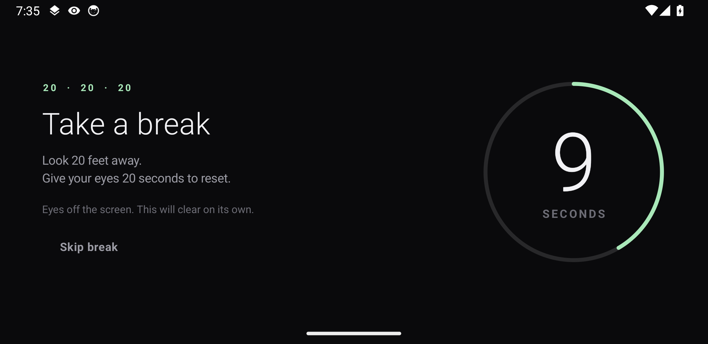

<h1 align="center">👁️ EyeCare</h1>

<p align="center">
  <strong>Give your eyes a break — automatically.</strong><br>
  A calm, full-screen 20-20-20 reminder for Android.
</p>

<p align="center">
  
  
  
  
</p>

---

> **The 20-20-20 rule:** every **20 minutes**, look at something **20 feet away** for **20 seconds**.

Screens make us forget to blink and refocus. EyeCare keeps the clock for you: after 20 minutes
of phone use, it gently covers the screen for 20 seconds and tells you to look away. No account,
no ads, no internet.

## ✨ What it does

- ⏱️ **Counts only real screen time.** The timer runs while your phone is unlocked, and pauses when
  you lock it.
- 🔔 **Warns you first.** A small “Break in 1 minute” card appears before the break, then
  “Break in 15 seconds”, so it never feels sudden.
- 🌑 **Covers any app.** The break screen appears above whatever you are doing, blocks touches for
  20 seconds, then clears itself.
- 🔄 **Resets when you step away.** If the phone stays locked for 5 minutes or more, the next
  session starts fresh.
- 📱 **Looks right everywhere.** Works in portrait and landscape.
- 🔁 **Survives restarts.** Protection comes back after a reboot.
- 🚫 **No ads. No accounts. No tracking. No internet permission.**

## 📸 A look at EyeCare

| Before the break | 15 seconds to go |
|:---:|:---:|
|  |  |
| **Break time — portrait** | **Break time — landscape** |
|  |  |

## 🚀 Get started

### 1. Install the app

If someone shared **`EyeCare.apk`** with you:

1. Copy the file to your phone and tap it.
2. If Android asks, allow **Install unknown apps** for the app you opened it from
   (Files, Chrome, etc.).
3. Tap **Install**. If Play Protect says the app is unknown, choose **More details → Install anyway**.

> Building it yourself? See [For developers](#for-developers).

### 2. Finish setup

Open **EyeCare** and tap through the three setup cards. Each one explains itself, but here is what
they do:

| Setup item | Why EyeCare needs it |
|---|---|
| **Display over other apps** | Lets the break screen appear above other apps. **Required.** |
| **Notifications** | Android requires an ongoing notification for apps that run in the background. EyeCare only shows its status there. |
| **Unrestricted background** | Asks Android not to freeze the timer. **Recommended** for accurate 20-minute cycles. |

Button names vary a little between phone brands — look for the closest match.

### 3. Start protection

Tap **Start protection**. You can close the app and use your phone normally. A quiet **EyeCare is
on** notification stays in the shade so you know it is running. Tap **Stop** there (or in the app)
whenever you want a pause.

**Want to see it now?** Tap **Preview the break screen** — no need to wait 20 minutes.

## 🕹️ How it feels to use

1. You use your phone as usual.
2. Around the 19-minute mark, a small **Break in 1 minute** card appears at the top of the screen.
3. At 19:45, it returns with **Break in 15 seconds**.
4. The screen turns dark for 20 seconds with a soft countdown ring and **Take a break**.
5. The break clears itself and a new 20-minute cycle begins.

**Skipping** is off by default. Turn on **Allow skipping** in the app if you want a **Skip break**
button on the break screen. Skipping still starts a fresh 20-minute cycle.

## ⚙️ Settings

| Setting | What it does |
|---|---|
| **Start / Stop protection** | Turns the 20-minute cycle on or off. |
| **Allow skipping** | Shows a **Skip break** button on the break screen. Off by default. |
| **Preview the break screen** | Shows the break screen immediately. |
| **Unrestricted background** | Opens the battery settings EyeCare needs. |

## 🔒 Privacy

EyeCare is deliberately boring about data:

- It has **no internet permission**, so it cannot send anything anywhere.
- No account, no sign-in, no analytics, no ads.
- The only thing it stores on your phone is the timer progress and your two preferences.

## ❓ Questions people ask

**I did not get a break. What should I check?**
Make sure **Protection is on**, **Display over other apps** is allowed, and EyeCare is not being
battery-restricted. On Xiaomi/Redmi/Poco, also enable **Autostart**; on Samsung, make sure EyeCare
is not in **Sleeping apps**.

**Does locking my phone reset the timer?**
Only if it stays locked for **5 minutes or more**. Short lock/unlock gaps resume where you left off.

**Why is the status bar still visible during a break?**
Android does not let ordinary overlay windows cover the status bar completely. Everything below it
goes dark, and the break still blocks touches on the rest of the screen.

**Will it really work after I restart my phone?**
Yes. If protection was on, EyeCare starts again after a reboot.

**Does it work offline?**
Completely. It does not ask for internet access at all.

**Can I use it without skipping?**
Yes — skipping is off by default, so the break always runs its full 20 seconds.

**Why does the notification not show the time left?**
That is intentional. The notification only tells you EyeCare is running, so it stays quiet and does
not update every minute.

## 🧠 How it works, briefly

EyeCare runs a small foreground service. It adds up the time your phone is **interactive and
unlocked**, shows a heads-up card at the 1-minute and 15-second marks, then draws the break screen
as an overlay above the current app. The overlay blocks touches, counts down 20 seconds, and
removes itself. Locking the phone pauses the clock; a lock of 5 minutes or more resets the cycle.

---

<a id="for-developers"></a>

## 🛠️ For developers

**Requirements:** JDK 17 or newer, Android Studio (or the command-line tools), Android 8.0+
(API 26+).

Build the debug APK:

```bash
./gradlew assembleDebug
```

The APK is written to:

```
app/build/outputs/apk/debug/app-debug.apk
```

Install it on a connected device:

```bash
adb install -r app/build/outputs/apk/debug/app-debug.apk
```

If `JAVA_HOME` points to an unsupported JDK, set it explicitly:

```bash
JAVA_HOME="/Applications/Android Studio.app/Contents/jbr/Contents/Home" \
  ./gradlew assembleDebug
```

Grant the runtime permissions while testing:

```bash
adb shell pm grant <applicationId> android.permission.POST_NOTIFICATIONS
adb shell appops set <applicationId> SYSTEM_ALERT_WINDOW allow
adb shell dumpsys deviceidle whitelist +<applicationId>
```

### Implementation notes

- The timer lives in `BreakService`, a foreground service with the `specialUse` FGS type, so it
  can keep running while the app is closed.
- The break is drawn by the service as a `TYPE_APPLICATION_OVERLAY` window. Android 10+ blocks
  background activity launches, and an overlay also appears above the current app.
- Screen state comes from `ACTION_SCREEN_ON`, `ACTION_SCREEN_OFF`, `ACTION_USER_PRESENT` and
  `ACTION_CONFIGURATION_CHANGED`. The last one rebuilds the overlay for portrait/landscape.
- Usage is persisted every 15 seconds, so a process restart loses very little progress.
- `BootReceiver` restarts the service after `BOOT_COMPLETED` when protection is enabled.
- If overlay permission is revoked while protection is on, the timer keeps running and EyeCare
  retries the break every 10 seconds.

### Project layout

```
app/src/main/java/com/iamfaizankhalid/eyecare/
├── BreakService.kt      timer, foreground service, overlay, warnings, notification
├── MainActivity.kt      onboarding, permissions, controls, status
├── CountdownRingView.kt custom countdown ring
├── ServiceState.kt      in-process state shared with the UI
├── Ui.kt                colors and small UI helpers
└── BootReceiver.kt      restart after reboot
```

## ⚠️ Known limitations

- The status bar can stay visible above the overlay on some Android versions.
- Some manufacturer battery managers stop background services aggressively. Allow autostart and
  unrestricted background use if breaks stop appearing.
- The break is intentionally not dismissible by touch unless **Allow skipping** is enabled.
